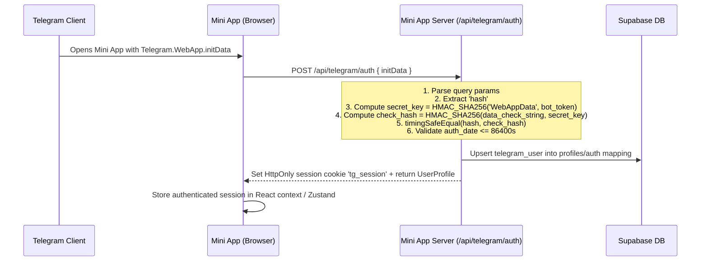

# Telegram Mini App Architecture Audit & Integration Map
**Project**: CCCGuru.in (NIELIT CCC Preparation Platform)  
**Date**: October 2026  
**Auditor**: Antigravity Full-Stack & System Architect

---

## 1. Executive Summary

This document establishes the architectural blueprint for the **CCCGuru Telegram Mini App**, connecting directly to the existing CCCGuru multi-platform ecosystem comprising:
1. **Public Website (`/website`)**: Production Next.js 16 (App Router), Tailwind CSS v4, `@supabase/ssr`, SSR/SSG/ISR architecture for public discovery, SEO, study materials, and practice exams.
2. **Mobile App (`/ccc-prep`)**: React Native / Expo application targeting Android/iOS with state synchronization and offline-first capabilities.
3. **Admin Panel (`/admin panel`)**: Vite + React administrative suite for managing categories, mock series, questions, chapters, study notes, blogs, and course curricula.
4. **Supabase PostgreSQL Backend**: Unified database hosting active questions, test series items, categories, chapters, enrollments, and user profiles.

The Telegram Mini App is architected to operate seamlessly inside Telegram clients (Android, iOS, Desktop, and Web) as a mobile-first, high-performance Web App while sharing the canonical Supabase database, data models, question bank, and scoring rules.

---

## 2. Repository & Project Structure Audit

```text
E:\App Dev 2026\CCC Prep\
├── website/                     # Public Next.js 16 App Router website
│   ├── src/app/                 # App Router pages (/tests, /chapters, /test-series, etc.)
│   ├── src/components/          # UI components (ExamInterface, TestSeriesCard, etc.)
│   ├── src/lib/                 # Data queries, Supabase clients, utility functions
│   └── src/types/database.ts    # Exact canonical Supabase TypeScript schemas
├── admin panel/                 # Admin console (Vite + React)
│   ├── src/lib/sqlSchema.ts     # Complete PostgreSQL DDL, indexes, and RLS policies
│   └── src/services/            # Data services for questions, series, enrollments
├── ccc-prep/                    # Expo / React Native mobile app
│   ├── src/store/               # Zustand stores (useTestStore, useProfileStore)
│   └── src/types/               # Mobile UI & profile types
├── mini-app/                    # DEDICATED TELEGRAM MINI APP WORKSPACE
│   ├── src/app/                 # Next.js App Router for Mini App
│   ├── src/components/          # Mobile-first interactive components
│   ├── src/lib/                 # Telegram auth, Supabase queries, test engine
│   └── docs/                    # Architecture and setup documentation
└── SRS.md                       # Platform System Requirements Specification
```

---

## 3. Database Schema & Data Models Audit

From `/admin panel/src/lib/sqlSchema.ts` and `/website/src/types/database.ts`, the unified Supabase schema consists of:

### 3.1. Test Categories (`test_categories`)
- `id` (UUID, PK)
- `title` (VARCHAR)
- `is_active` (BOOLEAN, default true)
- `sort_order` (INT, default 0)
- `created_at` (TIMESTAMPTZ)

### 3.2. Test Series (`test_series`)
- `id` (UUID, PK)
- `category_id` (UUID -> `test_categories.id`)
- `title` (VARCHAR), `slug` (VARCHAR UNIQUE)
- `description`, `description_md`, `featured_image`
- `is_featured` (BOOLEAN), `featured_tag`, `featured_short_desc`
- `total_sets_available` (INT), `total_enrolled` (INT)
- `is_paid` (BOOLEAN), `price` (NUMERIC), `currency` (VARCHAR)
- `created_at`, `last_updated_at` (TIMESTAMPTZ)

### 3.3. Test Series Items / Test Sets (`test_series_items`)
- `id` (UUID, PK)
- `series_id` (UUID -> `test_series.id`)
- `title` (VARCHAR)
- `test_type` (VARCHAR, e.g., 'Mock', 'Chapter')
- `question_count` (INT, default 100)
- `duration` (INT in minutes, default 90)
- `difficulty` ('Easy' | 'Medium' | 'Hard')
- `total_marks` (NUMERIC, default 100)
- `negative_marking_enabled` (BOOLEAN, default false)
- `negative_marks` (NUMERIC, default 0.00)
- `sort_order` (NUMERIC), `is_published` (BOOLEAN)
- `created_at` (TIMESTAMPTZ)

### 3.4. Chapters (`chapters`)
- `id` (UUID, PK)
- `title` (VARCHAR, English), `hindi_title` (VARCHAR, Hindi)
- `description` (TEXT), `sort_order` (INT 1-9), `is_active` (BOOLEAN)

### 3.5. Questions (`questions`)
- `id` (UUID, PK)
- `chapter_id` (UUID -> `chapters.id`)
- `question_en`, `question_hi` (TEXT)
- `option_a_en`, `option_a_hi`, `option_b_en`, `option_b_hi`
- `option_c_en`, `option_c_hi`, `option_d_en`, `option_d_hi`
- `correct_option` ('A' | 'B' | 'C' | 'D')
- `explanation_en`, `explanation_hi` (TEXT)
- `difficulty` ('Easy' | 'Medium' | 'Hard')
- `question_type` ('MCQ' | 'True/False')
- `source` (VARCHAR)
- `is_active` (BOOLEAN)
- `test_ids` (UUID[] array of test_series_item IDs)
- `created_at` (TIMESTAMPTZ)

### 3.6. Test Questions Junction (`test_questions`)
- `id` (UUID, PK)
- `test_series_item_id` (UUID -> `test_series_items.id`)
- `question_id` (UUID -> `questions.id`)
- `question_order` (INT)

### 3.7. User Profiles & Enrollments
- `profiles`: `id`, `full_name`, `email`, `avatar_url`, `phone_number`, `target_exam_date`
- `series_enrollments`: `id`, `user_id`, `series_id`, `access_type` ('free' | 'paid'), `status` ('active' | 'expired')
- `user_progress`: `user_id`, `tests_taken`, `accuracy_rate`, `day_streak`, `questions_solved`, `preparation_rate`

---

## 4. Test Lifecycle & Scoring Logic Audit

In the existing website (`ExamInterface.tsx`):
1. **Questions Fetching**:
   - Primary: `questions` table query with `contains('test_ids', [testSeriesItemId])`.
   - Fallback: `test_questions` junction table joined to `questions`.
2. **Options Detection**:
   - If question type is `True/False` or options C & D are empty, only options A and B are rendered.
   - Otherwise, 4 options (A, B, C, D) are available.
3. **Scoring Rules**:
   - Correct answer: `+1` mark.
   - Incorrect answer: `0` (or `-negative_marks` if `item.negative_marking_enabled` is true).
   - Skipped question: `0` marks.
   - Final score: `Math.max(0, score)`.
   - Accuracy: `Math.round((correct / attempted) * 100)` (0% if no questions attempted).
4. **Security Vulnerability in Website**:
   - The website loads full `Question` records including `correct_option` directly into the client component (`questions` prop in `ExamPage`), meaning tech-savvy users could inspect client state or network response to see answers during the test.
   - **Telegram Mini App Security Architecture**:
     - During an active test attempt, the server **omits** `correct_option`, `explanation_en`, and `explanation_hi`.
     - An attempt session is registered on the server with a cryptographically tracked start time.
     - Upon submission, the server fetches the real answer key, evaluates answers server-side, records score and timing, and only then returns evaluation details and explanations to the student.

---

## 5. Telegram Mini App Architecture

### 5.1. Authentication Architecture



### 5.2. Session Security Rules
1. **Never trust `initDataUnsafe`** on server endpoints.
2. The Telegram Bot Token is stored strictly server-side (`TELEGRAM_BOT_TOKEN`), never prefixed with `NEXT_PUBLIC_`.
3. Telegram session token is encrypted or signed (HMAC-SHA256) and set in an `HttpOnly`, `SameSite=Lax`, `Secure` (in production) cookie.
4. **Browser Preview Mode**: To allow local development without Telegram, a graceful sandbox environment is provided when `NODE_ENV === 'development'` or when `NEXT_PUBLIC_DEV_PREVIEW=true`. Preview mode assigns a sandbox student ID (`dev_preview_user`) and clearly identifies itself in the UI with a non-production badge.

### 5.3. Frame & Viewport Security
- Unlike the website's `X-Frame-Options: DENY`, the Telegram Mini App configures:
  - `Content-Security-Policy: frame-ancestors 'self' https://web.telegram.org https://*.telegram.org telegram:;`
  - Removal of `X-Frame-Options: DENY` on Mini App routes so Telegram Web client can render the iframe.
- Calls `window.Telegram.WebApp.ready()` and `window.Telegram.WebApp.expand()` upon mounting.
- Binds to `Telegram.WebApp.BackButton` to handle back navigation natively in the Telegram app header.

---

## 6. Route Structure

The Mini App uses Next.js App Router:

| Path | Description | Access |
|---|---|---|
| `/` | Mini App Home Dashboard (Resume test, daily quiz, chapter tests, full mocks, progress) | Authenticated / Preview |
| `/tests` | Full Mock Test Series listing & filterable catalog | Authenticated / Preview |
| `/chapters` | 9 NIELIT CCC Chapter-wise test modules | Authenticated / Preview |
| `/exam/[testId]` | Interactive Mobile Test Engine (Palette, bilingual, timer, mark-for-review) | Authenticated / Preview |
| `/results` | Student Results History (Past attempts, scores, time taken) | Authenticated / Preview |
| `/results/[attemptId]` | Detailed Evaluation & Solutions Review (Question-by-question explanations) | Authenticated / Preview |
| `/profile` | Student Profile, Telegram Identity, Language & Theme Preferences, Logout | Authenticated / Preview |
| `/auth/login` | Telegram WebApp verification landing & browser preview gate | Public |

### 6.1. API Route Structure

| Endpoint | Method | Purpose |
|---|---|---|
| `/api/telegram/auth` | POST | Verifies `initData` signature & issues session cookie |
| `/api/telegram/session` | GET | Returns currently authenticated Telegram student profile |
| `/api/telegram/logout` | POST | Clears session cookie |
| `/api/mini-app/dashboard` | GET | Aggregates user stats, recent attempts, featured series, and chapter tests |
| `/api/mini-app/tests` | GET | Fetches test categories and series |
| `/api/mini-app/tests/[testId]` | GET | Fetches test set details & metadata |
| `/api/mini-app/chapters` | GET | Fetches 9 official CCC chapters with test metadata |
| `/api/mini-app/attempts` | POST | Initiates a new test attempt (returns sanitized questions without answer keys) |
| `/api/mini-app/attempts/[attemptId]` | GET | Retrieves current state of an in-progress attempt |
| `/api/mini-app/attempts/[attemptId]/answers` | PUT | Saves/updates a question response in real time |
| `/api/mini-app/attempts/[attemptId]/submit` | POST | Server-side grading, negative marking calculation, score persistence |
| `/api/mini-app/results` | GET | Returns paginated attempt history for the authenticated student |
| `/api/mini-app/results/[attemptId]` | GET | Returns full evaluated result with answer keys and explanations |

---

## 7. Database Migration Strategy

The Supabase schema currently handles public test content and enrollments. To support server-evaluated attempts and response persistence for Telegram students, a clean non-destructive migration script is provided in `supabase/migrations/20261019_telegram_mini_app.sql`.

### New Tables:
1. `student_test_attempts`:
   - `id` (UUID PK)
   - `student_id` (TEXT / UUID) - Telegram user ID or Supabase auth ID
   - `student_type` (VARCHAR, 'telegram' | 'web')
   - `test_item_id` (UUID -> `test_series_items.id`)
   - `status` ('in_progress' | 'submitted' | 'evaluated' | 'abandoned')
   - `started_at` (TIMESTAMPTZ)
   - `submitted_at` (TIMESTAMPTZ)
   - `time_taken_seconds` (INT)
   - `score` (NUMERIC)
   - `total_marks` (NUMERIC)
   - `correct_count` (INT), `incorrect_count` (INT), `unanswered_count` (INT)
   - `accuracy` (NUMERIC)
   - `created_at` (TIMESTAMPTZ)

2. `student_attempt_answers`:
   - `id` (UUID PK)
   - `attempt_id` (UUID -> `student_test_attempts.id` ON DELETE CASCADE)
   - `question_id` (UUID -> `questions.id`)
   - `selected_option` (CHAR(1), NULL or 'A' | 'B' | 'C' | 'D')
   - `is_flagged` (BOOLEAN)
   - `time_spent_seconds` (INT)
   - `is_correct` (BOOLEAN)
   - `updated_at` (TIMESTAMPTZ)
   - `UNIQUE(attempt_id, question_id)`

### Fallback Resilience:
If the database migration has not been applied yet by the administrator, the server-side test engine includes an in-memory/encrypted cookie fallback session manager, ensuring zero crashes or 500 errors in development or initial rollout.

---

## 8. UI & UX Design System

- **Palette**:
  - Primary Accent: Deep Purple `#6610f2` / Vibrant Indigo `#8b32f4`
  - Secondary Accent: Cyan `#1a8fe3`
  - Success: Emerald `#10b981`
  - Danger / Flag: Rose `#f43f5e`
  - Surfaces: `#ffffff` (light), `#090b14` (dark)
- **Typography**: Inter (400, 500, 600, 700, 800) with clear Hindi Unicode rendering.
- **Mobile First**:
  - Fixed safe bottom navigation (Home, Tests, Chapters, Results, Profile).
  - Expandable drawer for quick question palette navigation.
  - Haptic feedback support through `Telegram.WebApp.HapticFeedback` when selecting options and submitting tests.
  - Zero horizontal overflow and touch targets >= 44px.
